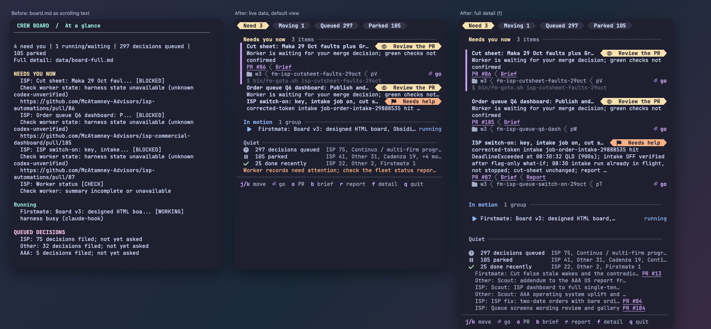
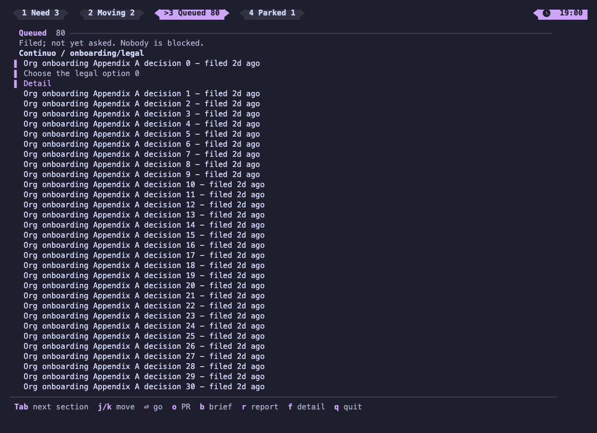

# Crew board and pane labels

Firstmate keeps a terminal board in a persistent pane beside firstmate in Herdr, with `data/board.md` as its plain-text fallback.
The board is a presentation of the canonical fleet snapshot used by bearings, including structured backlog decisions and each local second mate's own home snapshot.
It reads cached forge evidence without waiting for network requests and does not authorize an action or change task state.

The existing supervision loop and status-surfacing path refresh the presentation automatically.
The board viewer also checks for changes between supervision cycles, with a 30-second backstop for CI or secondmate state that changes without a local status event.
Run `bin/fm-board.sh refresh` from the firstmate pane to initialize or restore it immediately.
Pane operations safely do nothing on other backends; `bin/fm-board.sh render` can still generate the Markdown file there.
The viewer needs only Python 3 and its standard library, with no third-party package to install.

## Reading the labels

Each live local Herdr worker pane has its task id followed by a state label.
`WORKING` and `CI RUNNING` distinguish implementation from checks.
`NEEDS ANSWER` is reserved for an actual open worker question.
`WAITING: <earlier task>` names an unresolved prerequisite rather than claiming the worker is implementing.
`HOLDING` means a worker is deliberately awaiting your word to continue.
`REVIEW` means an open worker question explicitly asks you to review the PR.
An opened PR or a merge request never implies a review request.
`CI RUNNING` shows how many required checks have passed out of the total, plus elapsed time since the earliest check started when the forge supplies a start time.
`CI FAILED` names the failing checks.
`CI GREEN` means all required checks passed; the action text separately names review, merge, or a production step.
`MERGED` and `CLOSED` identify terminal PR states, and `no checks configured` means the forge reports no required checks.
An opened PR never by itself grants merge approval.

Normal renders schedule background reads through GitHub's JSON-capable `gh` interface or the existing `glab` path for GitLab, including self-hosted instances.
`gh-axi` remains the operator interface; its formatted PR commands do not expose the required machine-readable check fields.
The PR evidence cache under `state/` is reused for about 60 seconds, including failures.
Rendering uses stale evidence immediately and marks it as cached while refreshing; the viewer never waits on a forge request.
A cold cache shows `CI FETCHING` until the background request finishes.
The refresh worker limits concurrent requests and imposes a short timeout on each CLI process group; exact cache layout and limits belong to `bin/fm_pr_state.py`.
Completed refreshes invalidate the board fingerprint so the next viewer cycle uses them.
Fetch failures name the reason, such as GitHub unreachable, no permission, PR not found, missing CLI, or request timed out.
A GitHub 404 cannot distinguish a missing PR from a private PR hidden by permissions, so that ambiguity is stated explicitly.
Every recorded task PR and historical status-log PR reference is refreshed, with related PR states in the full action text.
Pane labels, summary, full board, and Tab views all use the same projection.

Structured terminal status fields are worker-reported evidence, and a current forge result takes precedence when they disagree.
The reported next action and owner remain visible alongside the check state.
Legacy status prose still works but cannot prove green CI.
The status protocol and delivery-specific reporting instructions are owned by `bin/fm-brief.sh`; see [crew status reports](crew-status.md) for supervision behavior.
The default fleet snapshot remains offline.
Use `--snapshot <file>` for a completely offline board, optionally enriched with `--pr-snapshot <file>` from `bin/fm-bearings-snapshot.sh --include-prs --json`.
Offline evidence older than five minutes or inconsistent with the recorded head asks for a refresh with the specific reason; absent evidence says PR checks not fetched (offline snapshot).
No offline preview starts a fetch or reads the live forge cache.
`PAUSED` is a declared external wait, `BLOCKED` needs intervention or a current-state check, and `DONE` is completed work.
A reconciled open worker question takes precedence over delivery readiness; a generic backlog approval flag does not hide a green PR.
Second mate panes use their reconciled child work to distinguish questions, delivery readiness, deliberate holds, and dependencies.

Questions use the `needs-answer` notification class, separately configurable from the `pr-ready` review or merge tag in [notification configuration](configuration.md#producer-tag-notifications-confignotify).

## Reading the board

`data/board.md` is the pinned summary; its generated portion stays below 60 lines, independently of inventory size.
It shows overall counts, up to five groups needing you now, and up to four groups running or waiting on earlier work.
Long titles and action summaries are shortened, and overflow is counted rather than listed.
`data/board-full.md`, linked from the summary, contains every projected item with its full title, action, task reference, prerequisite references, and full HTTPS PR URLs.
Both files use the same canonical snapshot and local group mapping.
Second mate summaries remain bounded by the snapshot producer; incomplete or omitted records are disclosed rather than described as complete.

`NEEDS YOU NOW` means a current worker question, deliberate wait for your word, PR review or merge request, or a worker failure requiring intervention.
`QUEUED DECISIONS` counts filed decisions by programme; backlog eligibility alone never means the question has been asked.
`PARKED` counts deferred work with its bring-back trigger in the full detail file.
A worker's declared external wait also belongs there.
Completed entries stay in the full detail file for the current UTC date and preceding two dates; older prerequisites remain as chain context.
Unconfirmed or incomplete worker summaries request a state check.

Groups are Continuo, Cadenza, ISP, AAA, MCA website, Firstmate, and Other.
Continuo programme categories are multi-firm programme, gaps and competitor features, compensation, onboarding/legal, and other.
Dependency groups use existing backlog prerequisite ids within each operational home, never title similarity or a separate relationship store.
Linked programme records supply programme names; otherwise counts use the project and its configured category.
Linear sequences show each step's state in prerequisite order and what must happen before the sequence continues.
Branches name their prerequisites explicitly rather than implying a sequence between siblings.
Missing prerequisites and dependency cycles remain visible.
The compact summary shows one PR URL per group and counts any additional PRs in the full detail file.

## Terminal board



The pane draws `state/board-model.json`, the structured projection written by every render, in the colours of a Catppuccin Mocha terminal.
Pills like the Herdr and WezTerm tab bar carry the counts and each item's kind, and the default view stays within 34 lines whatever the inventory.
Yellow and peach mean the item needs you, green means ready to merge or done, blue means running, and grey means waiting, queued, or parked.
Mauve marks links and the selected item, and peach also marks a failure with an explicit Failed label.
Every state also has a word and an icon, so colour is never the only signal.

The default view shows up to five items that need you, with the selected one expanded to its question, links, and pane location.
Below them, each group in motion is one line with its dependency chain drawn as connected icons, then three summary lines for queued decisions, parked work, and recent completions.
`f` switches to the full view, where every item is expanded and every chain is drawn as a vertical rail with dashed connectors for waiting steps.



Keys:

- `j` and `k`, or the arrow keys, move the selection, and PageUp, PageDown, Home, and End scroll.
- Enter goes to the selected worker's pane.
- `o` opens its pull request, or its brief when it has none.
- `b` opens the brief, and `r` opens the report.
- Tab cycles Needs you now, In motion, Queued, and Parked; Shift-Tab goes back, and `1` to `4` jump directly.
- The active header pill has a `>` marker, and the last section is remembered across viewer restarts in the same terminal session.
- In motion lists selectable dependency steps with their state and pane location; Queued lists filed decisions and their age by programme, and Parked shows each bring-back trigger.
- Queued means filed and not yet asked; nobody is blocked by a queued decision.
- Enter on a queued decision or parked item opens its detail file; `b` and `r` open its brief and report when present.
- `f` switches between the summary and the full view, and `q` exits.

PR, brief, report, and detail links are also OSC 8 hyperlinks, so a terminal that supports them can click through.
A brief, report, or detail file inside an Obsidian vault opens as an `obsidian://open?vault=<folder name>&file=<path>` link, found from the nearest `.obsidian` folder above the file; any other file opens directly.
`bin/fm-board.sh view --once --width 60` prints one frame and exits, and `--select N`, `--detail`, and `--section 1` to `--section 4` choose the selection, full view, and section.

Glyphs use Nerd Font powerline and icon characters, which WezTerm bundles.
Set `FM_BOARD_ICONS=plain`, or put `plain` in `config/board-icons`, for plain Unicode on a terminal without that font.
`NO_COLOR` removes colour and implies plain glyphs.
The viewer writes truecolor escape sequences, so it needs a terminal that supports them.

The viewer updates only the screen rows that changed rather than clearing and repainting the display.
The adjacent split stays in firstmate's current tab without taking focus.
Repeated refreshes reuse the same home-specific pane; closing it allows a subsequent supervision refresh to recreate it.
If that pane was moved to another tab, refresh refuses to create a duplicate; return it beside firstmate or close it for recreation.
This is a persistent split, not a separate workspace or an Obsidian page.
The adapter verifies firstmate's live pane, tab, workspace, and session socket before creating anything.
Missing or contradictory identity refuses placement instead of guessing by workspace label.
The viewer environment is stored in a generated mode-0700 script under `state/`, and only its short launch command is sent after the shell prompt is ready.

## Going to a worker

Herdr has no URL scheme and cannot focus a pane by id, and `pane focus` only moves in a direction.
`herdr tab focus` does select the tab and its workspace, and each task owns a one-pane tab, so focusing the tab lands on the worker.
`bin/fm-goto.sh <task-id>` does exactly that.
It finds the task's metadata in this home or in a local second mate's own home, validates the recorded endpoint, confirms the pane still exists, and then focuses its tab.
It changes focus only, and it does nothing on another backend.
Enter in the board runs it for the selected item, and the same command can be run from any pane.
Every item shows the Herdr workspace, tab, and pane that command will use.

## Second mate workers and merged pull requests

For a second mate registered on this machine, the board runs the snapshot in that home and reads its workers and backlog from there, not from the bounded summary in firstmate's snapshot.
If that home cannot be read, the board falls back to the summary and asks for a state check.

Some harnesses cannot be classified from their pane, so the snapshot reports an unknown state.
Only in that case, the worker's last status event stands in for it.
A pause that waits for a merge decision on an open pull request shows its cached CI state, with an explicit fetching or failure reason when CI cannot be read; a pause without a PR shows as a declared external wait.
A pull request confirmed as merged is never offered for review or merge, and its worker shows as merged.

## Local group mapping and notes

Create `config/board-groups.json` in the operational home to override grouping.
Like other `config/` files, it is private and gitignored.
Custom rules run first, in order, before the built-in defaults.
The exact schema and matching rules belong to the header of `bin/fm-board.py`.
For example:

```json
{
  "rules": [
    {"repo": "mcatamney-site", "group": "MCA website"},
    {"repo": "continuo", "match": "allowances", "group": "Continuo", "category": "compensation"}
  ]
}
```

Invalid configuration leaves the existing board intact and prints a diagnostic when refreshed manually.
Run `bin/fm-board.sh --help` for rendering, offline snapshot-preview, and viewer commands.
Set `FM_BOARD_DISABLED=1` to suppress the board helper, including its automatic calls.

Add personal lines under the final `## My notes` heading in `data/board.md`.
Regeneration preserves that section verbatim, including indentation and blank lines.
Everything above that heading is generated.
The board file is replaced atomically, unchanged output is not rewritten, and an edit detected during generation causes that refresh to stop and retry later.
